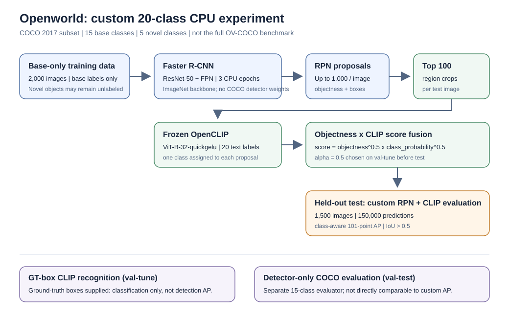
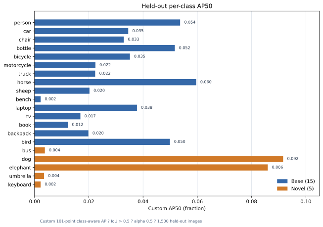

# Openworld: open-vocabulary detection on a small COCO subset

This Windows/CPU experiment combines a base-class object detector with frozen
OpenCLIP to label detector proposals across a custom set of 20 COCO categories.
It is a small experimental project, **not the full OV-COCO benchmark**.



## What was run

- **Dataset:** 2,000 training images, 500 validation-tune images, and 1,500
  held-out validation-test images.
- **Base classes (15):** person, car, chair, bottle, bicycle, motorcycle,
  truck, horse, sheep, bench, laptop, tv, book, backpack, bird.
- **Novel classes (5):** bus, dog, elephant, umbrella, keyboard.
- **Detector:** Faster R-CNN with ResNet-50 + FPN, trained for 3 epochs on CPU.
  The backbone starts from ImageNet weights; the detector has no COCO detection
  pretraining.
- **Region recognition:** frozen OpenCLIP ViT-B-32-quickgelu compares proposal
  crops against prompts for all 20 classes.
- **Fusion:** RPN objectness and CLIP class probability are combined with
  `alpha = 0.5`, selected on val-tune before the final test evaluation.

Training retains images that may contain novel objects but removes novel
annotations from detector supervision. Such objects can therefore appear
unlabeled during training.

## Saved results

The local final run records 150,000 RPN + CLIP predictions over the 1,500
held-out images (100 proposals per image). Results use the repository's custom,
class-aware 101-point AP at IoU **strictly greater than 0.5**:

| Class group              |   AP50 | 95% image-bootstrap interval |
| ------------------------ | -----: | ---------------------------: |
| Base (15 classes)        | 0.0314 |               0.0288-0.0401 |
| Novel (5 classes)        | 0.0374 |               0.0282-0.0574 |
| Generalized (20 classes) | 0.0329 |               0.0314-0.0429 |

Intervals use 200 image-level resamples (seed 42). They reflect resampling
uncertainty for this saved evaluation, not variation across training runs.
These are low absolute AP values for this particular protocol.



The separate detector-only evaluation reports COCO AP50 **0.073** and
COCO AP50:95 **0.027** on the 15 base classes. It uses `pycocotools.COCOeval`,
while the RPN + CLIP values above use a custom evaluator. These are not a
controlled same-metric comparison; **the results do not establish that CLIP
improved or worsened the detector**.

Ground-truth-box CLIP recognition is a third, different measurement: it
supplies the correct regions and measures class recognition, not localization
or end-to-end detection AP. The tuning/test and evaluator distinctions are
explained in the [reproduction notes](docs/reproducibility.md).

## Set up and use a selected COCO subset

The tracked repository does not include COCO images or the prepared
annotation subsets. You do not need to download all COCO photos: the
preparation step needs the COCO 2017 instance annotation JSONs, then the fetch
script downloads only the selected 2,000 training and 2,000 validation images.

From the repository root in PowerShell, create a CPU environment:

```powershell
python -m venv .venv
.\.venv\Scripts\Activate.ps1
python -m pip install --upgrade pip
python -m pip install torch torchvision --index-url https://download.pytorch.org/whl/cpu
python -m pip install -r requirements.txt
```

Place the official `instances_train2017.json` and `instances_val2017.json`
annotation files under `data/annotations/`, then prepare fixed subset
manifests and fetch only their images:

```powershell
python scripts\prepare_data.py --config configs\config.yaml
python scripts\fetch_images.py --subset data\annotations\instances_train2017.stripped.json --dest data\images\train2017 --jobs 16
python scripts\fetch_images.py --subset data\annotations\instances_val_tune2017.stripped.json --dest data\images\val2017 --jobs 16
python scripts\fetch_images.py --subset data\annotations\instances_val_test2017.stripped.json --dest data\images\val2017 --jobs 16
```

Check that each fetch reports `failed=0`. Preparation rewrites split files;
reuse the recorded manifests for this experiment rather than regenerating its
test split. Training, proposal extraction, and CLIP inference are lengthy on
CPU and are not needed to read the saved summary. See
[reproduction and artifact notes](docs/reproducibility.md) before running
notebooks or scripts.

## Limitations and public-release notes

- This is a custom 15-base/5-novel class subset, not full OV-COCO, and its
  numbers should not be compared directly to full-benchmark results.
- Small data and three CPU epochs limit the detector; novel objects in
  training images may have no corresponding training labels.
- The final AP values depend on this model, split, proposals, prompts,
  fusion setting, and custom metric. No multiple-seed training comparison is
  available.
- The `alpha = 1.0` tuning result is not a useful CLIP classification
  baseline: under the implemented fusion formula all classes tie when CLIP
  probability is raised to zero.
- No project license file is present. Review licensing and attribution for
  project code, COCO annotations, and pretrained weights before inviting reuse.

The local confusion matrix and additional artifact/Git-history findings are
described in the [reproduction notes](docs/reproducibility.md). No example
COCO photos are embedded in this README.

## License

Original project code is licensed under the [MIT License](LICENSE). COCO
images and annotations, pretrained models and weights, and third-party code
are not covered by this project license; each is subject to its own license
or terms.
